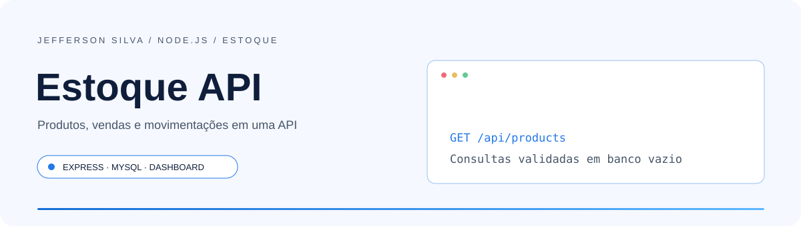
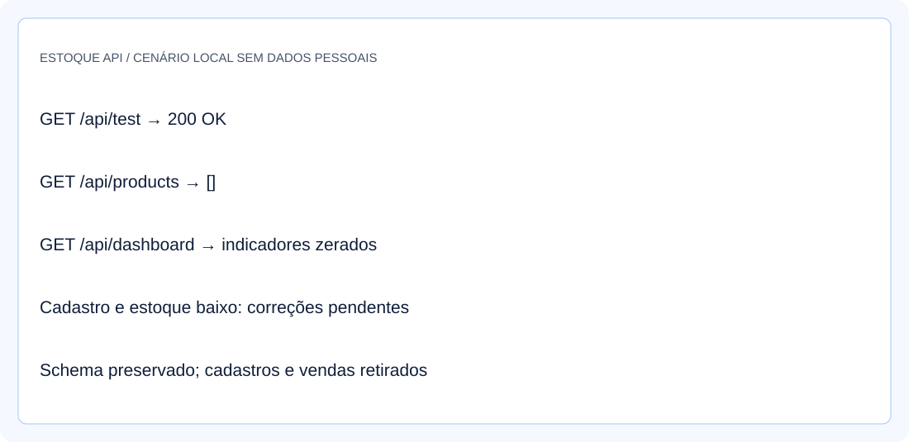
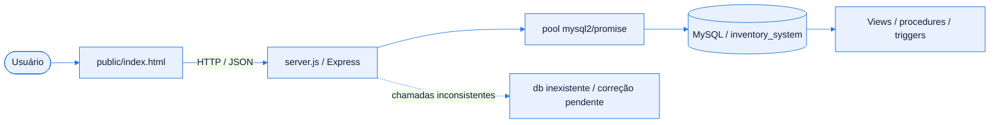
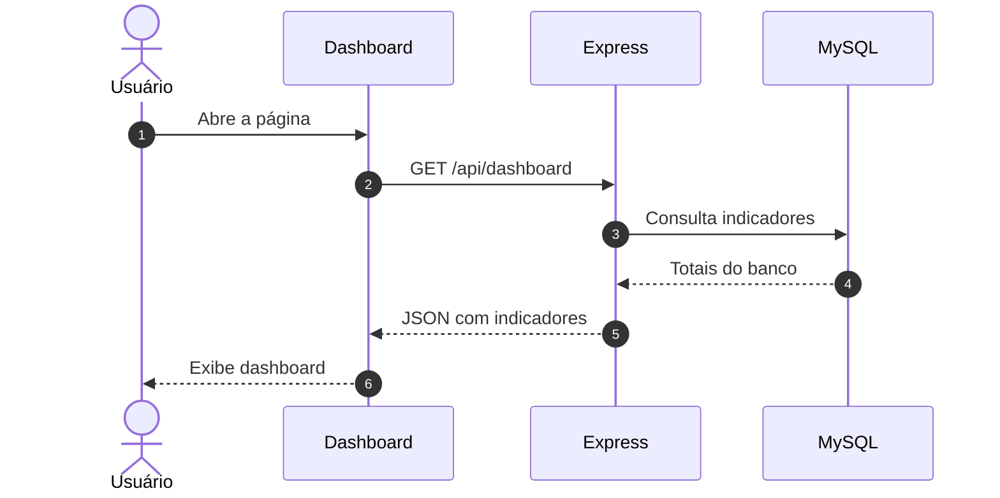
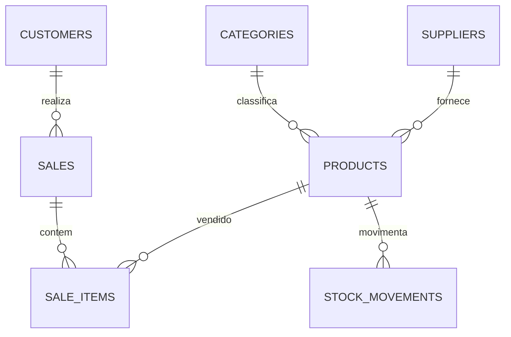

<!-- Jefferson Silva / README 4.0 — adaptado ao código de Estoque API. -->

<div align="center">

<picture>
  <source media="(prefers-color-scheme: dark)" srcset="./assets/banner-dark.svg" />
  <source media="(prefers-color-scheme: light)" srcset="./assets/banner-light.svg" />
  
</picture>

<br />
<br />

**API e dashboard para explorar produtos, vendas e movimentações de estoque.**

<p>
  <a href="#inicio-rapido"></a>
  <a href="https://github.com/jeffsilva03/estoqueBackEnd/issues/new"></a>
</p>

[](https://github.com/jeffsilva03/estoqueBackEnd/commits/)
[](https://github.com/jeffsilva03/estoqueBackEnd)
[](https://github.com/jeffsilva03/estoqueBackEnd)
[](https://github.com/jeffsilva03/estoqueBackEnd/issues)
[](https://github.com/jeffsilva03/estoqueBackEnd/stargazers)

<a href="#stack">
  <picture>
    <source media="(prefers-color-scheme: dark)" srcset="https://skillicons.dev/icons?i=js,nodejs,express,mysql&theme=dark" />
    
  </picture>
</a>

<br />
<br />

<a href="#visao-geral">Visão geral</a> &nbsp;•&nbsp;
<a href="#demonstracao">Demonstração</a> &nbsp;•&nbsp;
<a href="#funcionalidades">Funcionalidades</a> &nbsp;•&nbsp;
<a href="#stack">Stack</a> &nbsp;•&nbsp;
<a href="#arquitetura">Arquitetura</a> &nbsp;•&nbsp;
<a href="#inicio-rapido">Instalação</a> &nbsp;•&nbsp;
<a href="#exemplos">Exemplos</a> &nbsp;•&nbsp;
<a href="#roadmap">Roadmap</a> &nbsp;•&nbsp;
<a href="#contribuir">Contribuir</a>

</div>

<br />

> [!NOTE]
> **Status:** Protótipo parcial. Consultas e dashboard validados com banco vazio; cadastro, estoque baixo e parte das rotas precisam de correção. O histórico público contém dados/configurações antigas.

<a id="visao-geral"></a>
## ✦ Visão geral

**Estoque API** é um protótipo Node.js/Express com MySQL e um dashboard HTML para consultar produtos, vendas, fornecedores, clientes e indicadores. O código reúne rotas de consulta e escrita, mas há inconsistências entre a conexão MySQL e chamadas a uma variável `db` inexistente. Esta documentação distingue o que foi validado do que precisa de correção.

<table>
<tr>
<td width="33%" valign="top">

**🧩 Problema**

Centralizar cadastros, níveis de estoque e vendas em uma aplicação com indicadores.

</td>
<td width="33%" valign="top">

**🛠️ Solução**

Expõe endpoints Express e uma interface HTML que consome a API.

</td>
<td width="33%" valign="top">

**📈 Resultado**

Consultas básicas e dashboard respondem com o schema vazio; cadastro de produto e estoque baixo têm falhas confirmadas.

</td>
</tr>
</table>

<a id="demonstracao"></a>
## ◐ Demonstração

<div align="center">

<picture>
  <source media="(prefers-color-scheme: dark)" srcset="./assets/screenshot-dark.svg" />
  
</picture>

<sub>Ilustração baseada nas respostas locais do schema vazio. Funções de escrita permanecem parciais.</sub>

</div>

<details>
<summary><b>▶ Ver o fluxo em ação</b></summary>

Siga o [Início rápido](#inicio-rapido) e os [Exemplos de uso](#exemplos). As ilustrações não são capturas de contas ou bancos pessoais.

</details>

<a id="funcionalidades"></a>
## ◈ Funcionalidades

<sub>✅ Implementado &nbsp; 🚧 Parcial &nbsp; 🗓️ Planejado</sub>

| Módulo | O que faz | Estado |
| :-- | :-- | :-- |
| **Consultas** | Lista produtos, vendas, categorias, fornecedores e clientes | ✅ |
| **Dashboard** | Resumo de produtos, vendas e receita; validado sem registros | ✅ |
| **Produtos** | Cadastro usa `db` não definido; há duas rotas POST duplicadas | 🚧 |
| **Estoque baixo** | Rota é interceptada antes por `/api/products/:id` | 🚧 |
| **Vendas e relatórios** | Parte das rotas usa a variável `db` inexistente | 🚧 |
| **Autenticação** | Middleware JWT definido, mas não aplicado às rotas | 🚧 |

<details>
<summary><b>▶ Regras de negócio e validações</b></summary>

| Regra | Comportamento |
| :-- | :-- |
| Banco | MySQL via pool `mysql2/promise`; schema contém tabelas, views, procedures e triggers |
| Listagem de produtos | Filtra `is_active = true` e junta categoria/fornecedor |
| Campos do produto | Nome, SKU e preços são checados antes da falha de persistência |
| Movimentações | Há endpoint de ajuste e triggers; fluxos com dados não foram certificados |
| Identidade | Rotas atuais não exigem o middleware JWT existente |
| Dados de exemplo | Dump público contém somente estrutura; clientes, contatos e vendas foram retirados |

</details>

<a id="stack"></a>
## ⚙ Stack e decisões técnicas

| Camada | Tecnologia | Por que foi escolhida |
| :-- | :-- | :-- |
| Servidor | Node.js / Express 4 | Rotas HTTP e arquivos estáticos |
| Persistência | MySQL / MariaDB / mysql2 | Pool de conexões e consultas SQL |
| Interface | HTML / CSS / JavaScript / Chart.js | Dashboard que consome a API |
| Configuração | dotenv | Variáveis locais para porta e banco |
| Autenticação parcial | jsonwebtoken / bcryptjs | Dependências existentes; rotas não protegidas pelo middleware |
| Desenvolvimento | nodemon / Jest / Supertest | Ferramentas declaradas; ainda não há testes versionados |

> [!TIP]
> Foram retiradas seis dependências sem uso no código e 11.028 arquivos de `node_modules` do versionamento. `package-lock.json` foi preservado e atualizado para a instalação reproduzível.

<a id="arquitetura"></a>
## ⬡ Arquitetura



<details>
<summary><b>▶ Responsabilidade de cada componente</b></summary>

| Componente | Responsabilidade |
| :-- | :-- |
| `server.js` | Rotas, pool MySQL, middleware e servidor estático |
| `public/index.html` | Dashboard e formulários |
| `teste.html` | Cliente manual de teste; preservado como utilitário |
| `inventory_system.sql` | Estrutura sem registros pessoais ou operacionais |
| `.env.example` | Configuração local com valores ilustrativos |
| `railway.toml` | Configuração de processo existente; deploy não validado |

</details>

<details>
<summary><b>▶ Fluxo principal passo a passo</b></summary>



</details>

<details>
<summary><b>▶ Modelo de dados</b></summary>



O schema inclui também usuários, compras e itens de compra. São 10 tabelas, 2 procedures, 2 triggers e 2 views; a versão pública começa sem registros.

</details>

<a id="inicio-rapido"></a>
## ⚡ Início rápido

**Pré-requisitos**

| Ferramenta | Versão | Como verificar |
| :-- | :-- | :-- |
| Node.js | 22.22.0 usado na revisão | `node --version` |
| npm | Compatível com seu Node | `npm --version` |
| MySQL / MariaDB | MariaDB 10.4.32 usado na revisão | `mysql --version` |
| Git | Versão recente | `git --version` |

<details open>
<summary><b>Windows · PowerShell</b></summary>

```powershell
git clone https://github.com/jeffsilva03/estoqueBackEnd.git
cd estoqueBackEnd
npm ci
Copy-Item .env.example .env
# Configure as variáveis do seu banco local em .env.
# No cliente mysql, crie e selecione um banco novo:
mysql -u root -p
# CREATE DATABASE inventory_system CHARACTER SET utf8mb4;
# USE inventory_system;
# SOURCE C:/caminho/estoqueBackEnd/inventory_system.sql;
# EXIT;
npm start
```

</details>

<details>
<summary><b>▶ Linux / macOS</b></summary>

```bash
git clone https://github.com/jeffsilva03/estoqueBackEnd.git
cd estoqueBackEnd
npm ci
cp .env.example .env
# Configure o ambiente e crie um banco local dedicado.
mysql -u root -p -e "CREATE DATABASE inventory_system CHARACTER SET utf8mb4;"
mysql -u root -p inventory_system < inventory_system.sql
npm start
```

Sequência documentada, não executada neste ambiente.

</details>

> [!TIP]
> Abra **http://127.0.0.1:3000**. Com o schema novo, as consultas retornam listas vazias e o dashboard fica zerado. A instalação não inclui credenciais nem cadastros anteriores.

**Variáveis de ambiente**

| Variável | Obrigatória | Padrão | Descrição |
| :-- | :-- | :-- | :-- |
| `PORT` | — | `3000` | Porta da aplicação |
| `DB_HOST` | Configure | `localhost` no código | Servidor MySQL |
| `DB_PORT` | — | `3306` | Porta do MySQL |
| `DB_USER` | Configure | `root` | Usuário do banco local |
| `DB_PASSWORD` | Configure | Vazia | Senha do banco |
| `DB_NAME` | Configure | `inventory_system` | Nome do schema importado |
| `JWT_SECRET` | Se ativar autenticação | Fallback inseguro no código | Middleware existente, ainda não aplicado às rotas |

> [!IMPORTANT]
> Use um banco local novo. O histórico público contém versões antigas de `.env`; credenciais que ainda estiverem em uso devem ser trocadas. O protótipo tem rotas sem autenticação e falhas funcionais; consulte a [auditoria](./docs/auditoria-portfolio.md) antes de hospedá-lo.

<details>
<summary><b>▶ Problemas comuns</b></summary>

| Sintoma | Causa provável | Como resolver |
| :-- | :-- | :-- |
| `ECONNREFUSED` | MySQL parado ou porta incorreta | Confira serviço e `DB_HOST`/`DB_PORT` |
| Tabela inexistente | Schema não importado | Importe `inventory_system.sql` em banco novo |
| POST produto retorna 500 | Uso de `db` não definido | Correção funcional pendente no servidor |
| Estoque baixo retorna 404 | Rota genérica por ID é registrada antes | Reordenar/corrigir as rotas em mudança de implementação |
| `npm test` não encontra testes | Jest está configurado só como script | A suíte ainda precisa ser criada |

</details>

<a id="exemplos"></a>
## ◉ Exemplos de uso

<details open>
<summary><b>▶ Cenário principal</b></summary>

```powershell
$base = 'http://127.0.0.1:3000/api'
Invoke-RestMethod "$base/test"
Invoke-RestMethod "$base/products"
Invoke-RestMethod "$base/categories"
Invoke-RestMethod "$base/dashboard"
```

Em um banco novo: produtos e categorias retornam `[]`; os indicadores do dashboard ficam zerados. São exemplos de consulta, sem inserir dados pessoais.

</details>

<details>
<summary><b>▶ Endpoints da API</b></summary>

| Método | Rota | Descrição | Autenticação |
| :-- | :-- | :-- | :-- |
| `GET` | `/api/test` | Verificação HTTP sem banco | — |
| `GET` | `/api/products` | Lista produtos ativos | — |
| `GET` | `/api/categories`, `/api/suppliers`, `/api/customers` | Lista cadastros | — |
| `GET` | `/api/sales` | Lista vendas | — |
| `GET` | `/api/dashboard` | Indicadores | — |
| `POST` | `/api/products` | Parcial: erro 500 confirmado | — |
| `GET` | `/api/products/low-stock` | Parcial: 404 no banco vazio por colisão de rota | — |

Outras rotas de vendas, ajustes e relatórios existem no código, mas não estão certificadas como funcionais.

</details>

<details>
<summary><b>▶ Testes e qualidade</b></summary>

| Comando / verificação | O que faz |
| :-- | :-- |
| `npm run check` | Confere sintaxe de `server.js` |
| `npm test` | Executa Jest; atualmente falha porque não há testes |
| `npm audit` | Consulta alertas de dependências |
| Verificação HTTP local | Confere página, API de teste, consultas e falhas conhecidas |

Resultados e limitações em [Validação da documentação](./docs/validacao-readme.md). A remoção de dependências sem uso reduziu os alertas de 31 para 20; ainda há 2 críticos e 10 altos.

</details>

<a id="roadmap"></a>
## ◇ Roadmap

- [x] Implementar consultas e dashboard
- [x] Separar configuração local do código
- [x] Retirar dependências geradas e dados do dump público
- [ ] Unificar persistência em mysql2 e remover rotas duplicadas
- [ ] Corrigir precedência da rota de estoque baixo
- [ ] Aplicar autenticação, validação e testes
- [ ] Rotacionar credenciais expostas e tratar histórico
- [ ] Atualizar dependências com alertas de segurança

<sub>Os itens pendentes são sugestões de evolução, sem prazo definido. Acompanhe e sugira melhorias nas <a href="https://github.com/jeffsilva03/estoqueBackEnd/issues">issues</a>.</sub>

<a id="documentacao"></a>
## ▤ Documentação

<details>
<summary><b>▶ Estrutura de pastas</b></summary>

```text
estoqueBackEnd/
├── server.js
├── public/index.html
├── teste.html                 # ferramenta manual preservada
├── inventory_system.sql       # somente estrutura
├── assets/                    # banners e ilustrações nos dois temas
├── docs/                      # auditoria e validação
├── .env.example
├── .gitignore
├── package.json
├── package-lock.json
├── railway.toml
└── README.md
```

</details>

<details>
<summary><b>▶ Perguntas frequentes</b></summary>

**É uma API de estoque pronta para produção?**
Não. Consultas básicas foram validadas, mas há falhas em escrita, rotas e autenticação.

**O banco inclui clientes ou senhas de demonstração?**
Não. O script agora contém somente a estrutura, sem registros de clientes, fornecedores, usuários ou vendas.

**Por que `npm run migrate` foi retirado?**
Ele apontava para `scripts/migrate.js`, arquivo que não existe no repositório. O schema é importado pelo cliente MySQL.

**Qual é a licença?**
`package.json` declara MIT; o repositório não inclui um arquivo `LICENSE`.

</details>

<details>
<summary><b>▶ Limitações e segurança</b></summary>

- **Limitações:** rotas misturam pool MySQL com chamadas `db` não definidas; há rotas duplicadas e ausência de suíte de testes.
- **Segurança:** middleware JWT não é aplicado; respostas podem expor mensagens internas de banco; dependências ainda têm alertas.
- **Histórico:** dados e credenciais antigas continuam recuperáveis. A exclusão atual não substitui rotação de segredos ou tratamento do histórico.
- **Reportar vulnerabilidade:** use canal reservado com o autor, sem publicar os valores das credenciais.

</details>

<a id="contribuir"></a>
## ⇄ Contribuir

1. Faça um fork e crie uma branch: `git checkout -b feat/minha-melhoria`
2. Faça commits seguindo o padrão abaixo
3. Rode `npm run check`, confira os fluxos alterados e execute os testes disponíveis antes de abrir o PR
4. Abra um Pull Request descrevendo o que mudou e por quê

<details>
<summary><b>▶ Padrão de commits</b></summary>

| Prefixo | Quando usar | Exemplo |
| :-- | :-- | :-- |
| `feat` | Nova funcionalidade | `feat: adiciona filtro por data` |
| `fix` | Correção de bug | `fix: corrige cálculo do total` |
| `docs` | Só documentação | `docs: atualiza instalação` |
| `refactor` | Mudança interna sem alterar comportamento | `refactor: separa serviço de e-mail` |
| `test` | Testes | `test: cobre fluxo de login` |
| `chore` | Configuração e manutenção | `chore: atualiza dependências` |

</details>

## ◎ Autor

<table>
<tr>
<td align="center" width="140">
  <a href="https://github.com/jeffsilva03"></a>
</td>
<td>

**Jefferson Silva**<br />
Portfólio · Estoque API<br />
Protótipo de estoque com Express, MySQL e dashboard.

<a href="https://github.com/jeffsilva03"></a>

</td>
</tr>
</table>

---

<div align="center">

Se este projeto foi útil, considere deixar uma ⭐ — isso ajuda outras pessoas a encontrá-lo.

<br />

<a href="#visao-geral"></a>

<sub>Node.js &nbsp;•&nbsp; Express &nbsp;•&nbsp; MySQL</sub>

</div>
